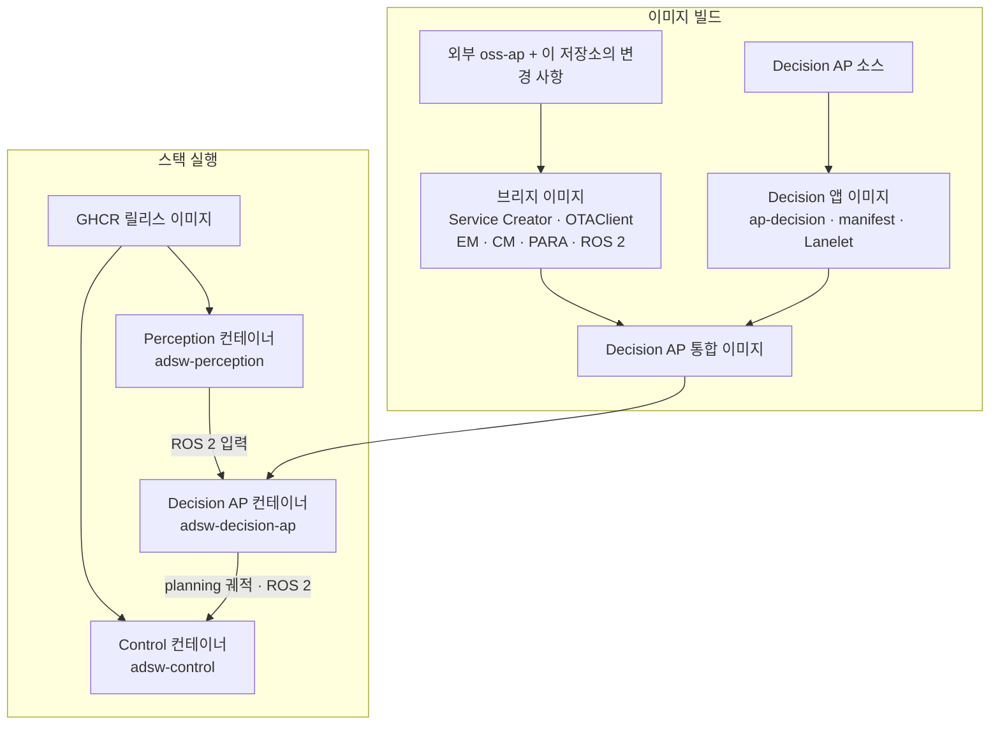

# Decision AP

Autoware의 Decision 파티션을 Adaptive AUTOSAR 기반으로 이식한 프로젝트다. Decision 앱(`ap-decision`)이 경로·행동·속도 planning을 수행해 최종 궤적을 생성하고, Service Creator가 ROS 2와 SOME/IP 서비스 간 통신을 연결한다. Decision 앱과 브리지 실행 환경을 하나의 통합 이미지로 구성하며, Perception·Control과 함께 각각 별도 컨테이너로 실행한다.

릴리즈 태그와 Internal GHCR 통합 이미지 발행 절차는 [Decision AP 태깅 및 릴리즈 규칙](release/README.md)을 따른다.


## 폴더 구조

```text
decision-ap/
├── README.md
├── CMakeLists.txt                    # planning 라이브러리 빌드 구성
├── src/Ecu_Machine/
│   ├── CMakeLists.txt                # Adaptive Decision 앱 빌드·설치 구성
│   ├── DecisionAP/
│   │   ├── src/                      # planning 알고리즘과 Adaptive 앱 구현
│   │   ├── include/                  # Decision 앱 헤더
│   │   └── manifest/                 # Decision 앱 실행·서비스 설정
│   ├── EM/manifest/                  # 실행 관리 설정
│   ├── CM/manifest/                  # Decision 앱 SOME/IP 통신 설정
│   └── cmake/                        # 브리지 빌드·크로스 컴파일 설정
├── overrides/
│   ├── Ecu_Machine/                  # 기반 oss-ap에 적용하는 변경분
│   │   ├── Exe_ServiceCreator/       # 브리지 소스와 서비스 manifest
│   │   ├── OTAClient/                # OTAClient 실행 manifest 변경분
│   │   └── CM/bridge-manifest/        # 브리지 SOME/IP 통신 설정
│   └── generated/
│       └── decision-ap-generated/    # oss-ap에 없는 생성 ARA 헤더·타입 18개
│           └── Exe_ServiceCreator/include/oss/
├── docker/
│   ├── build-x86.sh                  # x86_64 이미지 빌드 진입점
│   ├── build-arm64.sh                # ARM64 이미지 빌드 진입점
│   ├── run-x86.sh                    # x86_64 스택 실행
│   ├── run-arm64-board.sh            # ARM64 보드 스택 실행
│   ├── run-arm64-qemu.sh             # x86_64 PC에서 ARM64 스택 실행
│   ├── run-remote-rviz.sh            # 외부 x86_64 PC의 RViz 실행
│   ├── build/                       # 빌드 입력 준비와 이미지 생성 로직
│   ├── images/                      # Dockerfile
│   ├── run/                         # 스택 공통 실행 로직
│   ├── entrypoint/                  # 컨테이너 내부 초기화와 EM 시작
│   └── tools/                       # 생성 헤더 준비·이미지 병합·진단 도구
├── release/                         # 통합 이미지 태깅·GHCR 릴리즈 절차
├── sdk/                             # ../oss-ap/sdk에서 복사한 PARA SDK (Git 제외)
├── external/msgs/                   # ../oss-ap/oss-ap.repos로 가져온 메시지 소스 (Git 제외)
├── lib/                             # Lanelet2·planning 계산 의존 라이브러리
├── cmake/                           # planning 라이브러리 CMake 보조 파일
├── map/sample-map-decision/          # 샘플 지도
├── ros/                             # ROS 2 시각화 보조 코드
├── docs/                            # 구성·인터페이스·변경 내역 문서
└── output/                          # 실행 로그 등 산출물 (Git 제외)
```

## 1. 이미지 준비와 실행

### 1.1. 실행 위치별 이미지 준비와 실행

#### 1.1.1. GHCR 릴리즈 Decision 이미지를 사용할 때

`adsw-decision-ap`은 Internal 패키지다. 패키지 읽기 권한이 있는 GitHub 계정으로 personal access token (classic)을 만들고 `read:packages` 권한을 부여한다. 조직에서 SSO를 요구하면 토큰에도 SSO 접근을 승인한다. 이미지를 받을 장비마다 다음 명령으로 로그인한다. `YOUR_GITHUB_USER`는 본인 GitHub 사용자 이름으로 바꾼다. ([GitHub의 GHCR 인증 안내](https://docs.github.com/en/packages/working-with-a-github-packages-registry/working-with-the-container-registry#authenticating-to-the-container-registry))

```bash
read -r -s -p 'GHCR token: ' GHCR_TOKEN; echo
printf '%s' "$GHCR_TOKEN" | docker login ghcr.io -u YOUR_GITHUB_USER --password-stdin
unset GHCR_TOKEN
```

같은 터미널에서 이미지 변수를 설정한 뒤 아래 표의 명령을 실행한다.

```bash
DECISION_IMAGE=ghcr.io/oss-test-group/adsw-decision-ap:v0.1.0
```

| 실행 위치 | 통합 이미지 받기 | 스택 실행 | RViz | 외부 x86_64 PC에서 실행 |
| --- | --- | --- | --- | --- |
| x86_64 PC | `docker pull --platform linux/amd64 "$DECISION_IMAGE"` | `INTEGRATED_IMAGE="$DECISION_IMAGE" ./docker/run-x86.sh` | Perception 컨테이너에서 PC 화면에 표시 | 필요 없음 |
| ARM64 보드 | `docker pull --platform linux/arm64 "$DECISION_IMAGE"` | `KATECH_NETWORK_INTERFACE="$BOARD_LAN_INTERFACE" INTEGRATED_IMAGE="$DECISION_IMAGE" ./docker/run-arm64-board.sh` | 외부 x86_64 PC에서 별도 실행 | `KATECH_NETWORK_INTERFACE="$PC_LAN_INTERFACE" ./docker/run-remote-rviz.sh` |
| x86_64 PC에서 ARM64 QEMU 시험 | `docker pull --platform linux/arm64 "$DECISION_IMAGE"` | `INTEGRATED_IMAGE="$DECISION_IMAGE" ./docker/run-arm64-qemu.sh` | ARM64 Perception 컨테이너에서 PC 화면에 표시 | 필요 없음 |

보드의 이름이 `eth0`이면 `BOARD_LAN_INTERFACE=eth0`으로 설정한다. PC에서는 `PC_LAN_INTERFACE`만 설정하면 된다.

#### 1.1.2. Decision 이미지를 직접 빌드할 때

| 실행 위치 | 통합 이미지 빌드 | 스택 실행 | RViz | 외부 x86_64 PC에서 실행 |
| --- | --- | --- | --- | --- |
| x86_64 PC | `./docker/build-x86.sh` | `./docker/run-x86.sh` | Perception 컨테이너에서 PC 화면에 표시 | 필요 없음 |
| ARM64 보드 | `./docker/build-arm64.sh` | `KATECH_NETWORK_INTERFACE="$BOARD_LAN_INTERFACE" ./docker/run-arm64-board.sh` | 외부 x86_64 PC에서 별도 실행 | `KATECH_NETWORK_INTERFACE="$PC_LAN_INTERFACE" ./docker/run-remote-rviz.sh` |
| x86_64 PC에서 ARM64 QEMU 시험 | `./docker/build-arm64.sh` | `./docker/run-arm64-qemu.sh` | ARM64 Perception 컨테이너에서 PC 화면에 표시 | 필요 없음 |

보드의 이름이 `eth0`이면 `BOARD_LAN_INTERFACE=eth0`으로 설정한다. PC에서는 `PC_LAN_INTERFACE`만 설정하면 된다.

### 1.2. 이미지 구성 및 빌드 명령이 수행하는 작업

이 저장소의 빌드 명령은 **Decision AP 실행에 필요한 브리지, Decision 앱, 통합 이미지**를 만든다. Perception과 Control은 GHCR에 배포된 릴리스 이미지를 사용한다.

| 구성 | 이미지 설명 | 준비 방법 | 이미지 태그 또는 배포 위치 |
| --- | --- | --- | --- |
| Perception | 지도·인지·샘플 시뮬레이션 구성과 RViz를 포함하며, planning에 필요한 ROS 2 입력을 제공 | 실행 시 기본 GHCR 이미지가 로컬에 없으면 대상 아키텍처의 릴리스 이미지를 내려받음 | `ghcr.io/oss-test-group/adsw-perception:latest` |
| Control | planning 궤적을 받아 차량 제어를 수행하며, System 상태 감시·진단 구성을 포함 | 실행 시 기본 GHCR 이미지가 로컬에 없으면 대상 아키텍처의 릴리스 이미지를 내려받음 | `ghcr.io/oss-test-group/adsw-control:latest` |
| 브리지 이미지 | ROS 2↔SOME/IP를 연결하는 Service Creator, OTAClient, EM·CM, PARA·ROS 2 실행 환경을 포함 | 이 저장소의 빌드 명령으로 생성 | `decision-ap-bridge:local` |
| Decision 앱 이미지 | Adaptive AUTOSAR 기반 Decision 앱을 담은 이미지. 경로·행동·속도 planning과 최종 궤적을 생성하는 `ap-decision`, 앱 manifest, Lanelet 라이브러리를 포함 | 이 저장소의 빌드 명령으로 생성 | `decision-ap-planning:local` |
| 통합 이미지 | 브리지 실행 환경에 Decision 앱을 합친 최종 이미지. 하나의 EM·CM 아래에서 Service Creator·OTAClient·Decision 앱을 실행 | 브리지와 Decision 앱 이미지를 합쳐 생성 | `decision-ap-integrated:local` |

위 Decision AP 이미지 태그는 x86_64 기준이다. ARM64 빌드는 각각 `:local-aarch64`를 사용하며, 최종 이미지는 `decision-ap-integrated:local-aarch64`다.


### 빌드시 팝콘사 'oss-ap' 참조

기본 외부 저장소는 이 저장소 밖의 `../oss-ap/`이며, 없으면 빌드 스크립트가 복제한다. 빌드 시 `oss-ap`를 커밋 `2f649badb4a63e47e7df89c5b5b1675a70fa6ad5`로 맞춘다. `OSS_AP_SOURCE`로 다른 위치를 지정할 수 있다.

| 항목 | 실제 출처와 사용 방식 | 이 저장소의 Git |
| --- | --- | --- |
| `oss-ap.repos` | `../oss-ap/oss-ap.repos`를 직접 읽어 ROS 2 메시지 저장소를 가져옴 | 제외 |
| `sdk/` | `../oss-ap/sdk/`에서 필요한 아키텍처의 PARA SDK를 로컬로 복사 | 제외 |
| `external/msgs/` | 원본 `oss-ap.repos`에 기록된 별도 ROS 2 메시지 저장소를 가져옴 | 제외 |
| `oss-ap/src/Ecu_Machine/` | 외부 `oss-ap` 작업 트리에서 Docker 빌드 입력으로 사용 | 제외|
| `overrides/Ecu_Machine/`, `overrides/generated/` | oss-ap 원본과 다른 수정 파일 및 원본에 없는 생성 헤더만 보관 | 저장소에서 추적 |

### 1.3. 실행 명령이 수행하는 작업

`./docker/run-x86.sh`, `./docker/run-arm64-board.sh`, `./docker/run-arm64-qemu.sh`는 아키텍처와 네트워크·RViz 설정을 선택하고, 공통 실행 스크립트가 다음 세 컨테이너를 시작한다.

| 컨테이너 | 사용하는 이미지 | 실행 내용 |
| --- | --- | --- |
| `adsw-perception` | GHCR Perception 릴리스 이미지 | `sample_adsw_perception_run.launch.xml`로 지도·인지·샘플 시뮬레이션 구성 실행. PC·QEMU 모드에서는 RViz도 실행 |
| `adsw-control` | GHCR Control 릴리스 이미지 | `sample_adsw_control_run.launch.xml`로 제어 및 System 구성 실행 |
| `adsw-decision-ap` | 로컬 빌드 또는 GHCR에서 받은 Decision AP 통합 이미지 | entrypoint가 실행 환경을 준비하고 EM을 시작. EM이 CM·Service Creator·OTAClient·Decision 앱을 실행 |

Perception·Control은 위 표의 GHCR 이미지를 직접 사용하며, 로컬에 없을 때만 대상 아키텍처로 내려받는다. 다른 이미지는 `KATECH_PERCEPTION_IMAGE`와 `KATECH_CONTROL_IMAGE`로 지정하고 직접 준비한다. Decision AP 통합 이미지는 로컬에서 빌드하거나 1.1.1절에 따라 GHCR에서 받아 실행한다.

스택은 기본적으로 `ROS_DOMAIN_ID=42`, planning 시뮬레이션 모드 `PLANNING_AA_SIMULATION=1`로 실행된다. 실행 터미널에서 `Ctrl+C`를 누르면 스택이 종료되고 로그는 남는다.

### 1.4. ARM64 보드와 외부 PC RViz

1.1절에 따라 보드에서 `BOARD_LAN_INTERFACE`를 설정하고, 외부 PC에서 `PC_LAN_INTERFACE`를 설정한다. 보드에서는 다음 명령으로 스택을 시작한다.

```sh
KATECH_NETWORK_INTERFACE="$BOARD_LAN_INTERFACE" ./docker/run-arm64-board.sh
```

보드는 host 네트워크를 사용하며 RViz 창을 열지 않는다. 외부 PC에는 Docker, X11 데스크톱, x86_64 Perception 이미지가 필요하다. RViz 스크립트의 기본 이미지는 `ghcr.io/oss-test-group/adsw-perception:latest`이므로 아래처럼 이미지를 내려받은 뒤 실행한다. 별도의 로컬 태그나 `KATECH_RVIZ_IMAGE` 지정은 필요하지 않다.

```sh
docker pull --platform linux/amd64 ghcr.io/oss-test-group/adsw-perception:latest
KATECH_NETWORK_INTERFACE="$PC_LAN_INTERFACE" ./docker/run-remote-rviz.sh
```

보드와 PC의 `ROS_DOMAIN_ID`를 같게 설정한다. RViz에서 map·TF·route·trajectory가 보이지 않으면 양쪽 인터페이스 설정과 LAN의 UDP multicast·방화벽을 확인한다. 외부 PC에서 ROS 2나 Autoware를 별도로 빌드할 필요는 없다.

## 2. RViz 설정과 경로 요청

x86_64 PC 실행과 QEMU 실행은 PC의 `DISPLAY` 및 X11 소켓 `/tmp/.X11-unix`가 필요하다. 외부 PC RViz도 X11 데스크톱 터미널에서 시작한다. RViz 실행 파일과 기본 화면 구성은 Perception 이미지에 포함돼 있다. RViz의 Fixed Frame은 `map`으로 설정한다.

1. 지도와 TF가 표시될 때까지 기다린다.
2. `2D Pose Estimate`로 차량 초기 위치와 방향을 지정한다. 샘플 시뮬레이터의 `waiting initialization...` 상태는 유효한 초기 위치를 입력해야 끝난다.
3. `2D Goal Pose`로 목표 위치와 방향을 지정한다.
4. route와 `/planning/scenario_planning/trajectory`가 발행되는지 확인한다. 제어 궤적은 국소 구간만 표시하므로 목표 지점보다 앞에서 끝나 보일 수 있다.
5. 시뮬레이션 주행이 필요하면 route와 trajectory가 생성된 뒤 RViz의 Autonomous 모드를 켠다.

route는 `/planning/mission_planning/route`, 제어 궤적은 `/planning/scenario_planning/trajectory`로 발행된다. `ros/goal_pose_visualizer.py`는 route의 목표 자세만 `/planning/mission_planning/echo_back_goal_pose`로 재발행한다.

## 3. 설정 변경

환경변수를 수정하고 싶은 경우 실행 명령 앞에 붙인다. 예: `KATECH_MAP_PATH=/data/map ./docker/run-x86.sh`.

| 변수 | 용도 |
| --- | --- |
| `KATECH_MAP_PATH` | 샘플 지도 대신 사용할 지도 디렉터리 |
| `KATECH_PERCEPTION_IMAGE`, `KATECH_CONTROL_IMAGE` | Perception·Control 이미지 태그 |
| `INTEGRATED_IMAGE` | Decision AP 통합 이미지 태그. 기본값은 x86_64 `decision-ap-integrated:local`, ARM64 `decision-ap-integrated:local-aarch64` |
| `KATECH_NETWORK_INTERFACE` | 보드 스택과 외부 PC RViz가 통신할 LAN 인터페이스 |
| `KATECH_RVIZ_IMAGE` | 다른 RViz 이미지를 사용할 때 지정. 기본값은 `ghcr.io/oss-test-group/adsw-perception:latest` |
| `ROS_DOMAIN_ID` | ROS 2 도메인; 기본값 `42` |
| `MMF_DDS_DOMAIN_ID` | OTAClient가 사용하는 DDS 도메인; 기본값 `42` |
| `PLANNING_AA_SIMULATION` | `1`: 샘플 시뮬레이션, `0`: 실제 신호 입력 사용 |
| `PLANNING_AA_STATIC_MAP` | `1`: 첫 지도만 해독, `0`: 실행 중 지도 변경 허용 |
| `KATECH_LOG_DIR`, `KATECH_LOG_WINDOWS` | 로그 저장 위치와 데스크톱 로그 창 표시 |
| `PLANNING_AA_SHM_SIZE` | 통합 컨테이너 공유 메모리 크기; 기본 `2g` |
| `PLANNING_AA_AVOIDANCE_DEBUG` | `1`: 회피 대상 선택·거부 단계를 로그에 기록 |

## 4. 로그 확인

실행 화면의 `Logs:` 줄이 해당 실행의 로그 디렉터리다. 기본 위치는 `output/katech-logs/<실행 시각>/`이다. 실시간으로 보려면 다른 터미널에서 `tail -F <로그 디렉터리>/*.log`를 실행한다.

| 파일 | 확인할 내용 |
| --- | --- |
| `decision-ap.log`, `adsw-decision-ap.log` | 지도 해독, route 요청·응답, planning·궤적 송신 |
| `adsw-perception.log` | 지도 로딩, RViz 초기 위치·목표 입력 |
| `adsw-control.log` | Control 노드와 토픽 상태 |
| `trajectory-diagnostic.log` | Control에서 본 route·trajectory 수신과 궤적 샘플 |
| `validator-diagnostic-bridge.log` | planning 검증 진단 어댑터 |
| `goal-pose-visualizer.log` | route 목표 자세 재발행 노드 |

## 용어
이 문서에서 **Decision AP는 전체 파티션**, **Decision 앱은 그 안에서 planning을 수행하는 실행 프로그램**을 뜻한다.

| 구분 | 문서에서 사용하는 이름 | 실제 이름 |
| --- | --- | --- |
| 프로젝트·전체 파티션 | Decision AP | 저장소 `decision-ap` |
| 실행 프로그램 | Decision 앱 | 실행 파일 `ap-decision`, AUTOSAR 앱 식별자 `DecisionAP` |
| Decision 앱의 빌드 이미지 | Decision 앱 이미지 | 로컬 빌드 `decision-ap-planning:local` |
| Decision AP의 GHCR 패키지 | 통합 실행 이미지 | `ghcr.io/oss-test-group/adsw-decision-ap:<버전>` |
| 통신·앱 실행 기반 이미지 | 브리지 이미지 | `decision-ap-bridge:local` |
| Decision 앱과 브리지를 합친 최종 이미지 | 통합 이미지 | `decision-ap-integrated:local` |
| 최종 이미지로 시작하는 컨테이너 | Decision AP 컨테이너 | `adsw-decision-ap` |

이미지 태그는 x86_64 기준이며 ARM64는 `:local-aarch64`를 사용한다. 브리지에는 Service Creator·OTAClient·EM·CM과 실행 환경이 포함된다. `DecisionAP`는 manifest·서비스 경로에 사용하는 내부 식별자다.

GHCR에는 **통합 실행 이미지를 `adsw-decision-ap` Internal 패키지로 릴리스**한다. 브리지와 Decision 앱 이미지는 빌드 중간 산출물이다. 아키텍처별 staging 게시와 manifest 조립 절차는 [릴리스 문서](release/README.md)에 있다.

컨테이너 이름 `adsw-decision-ap`는 통합 이미지로 시작한 실행 인스턴스의 이름이다. 일반 빌드·실행 스크립트는 계속 로컬 이미지를 사용하며, 릴리스 이미지는 `INTEGRATED_IMAGE`로 명시해 실행한다.

## 범위와 기술 문서

이 저장소는 차로 주행용 Planning을 대상으로 한다. 주차 기능, 원본 Decision 전체와의 동등성, 실차 주행은 완료 범위에 포함되지 않는다. SDK와 생성 파일을 포함한 실행 이미지는 해당 라이선스 조건을 확인한 뒤 배포해야 한다.
